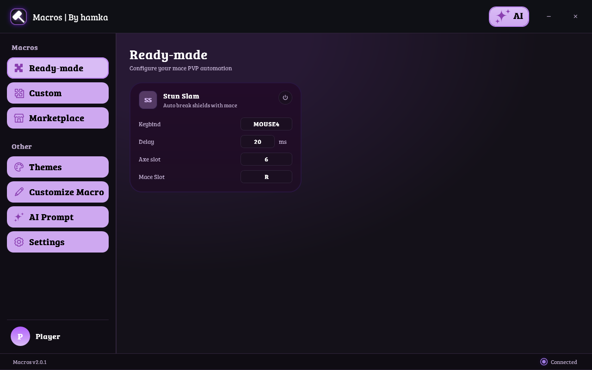
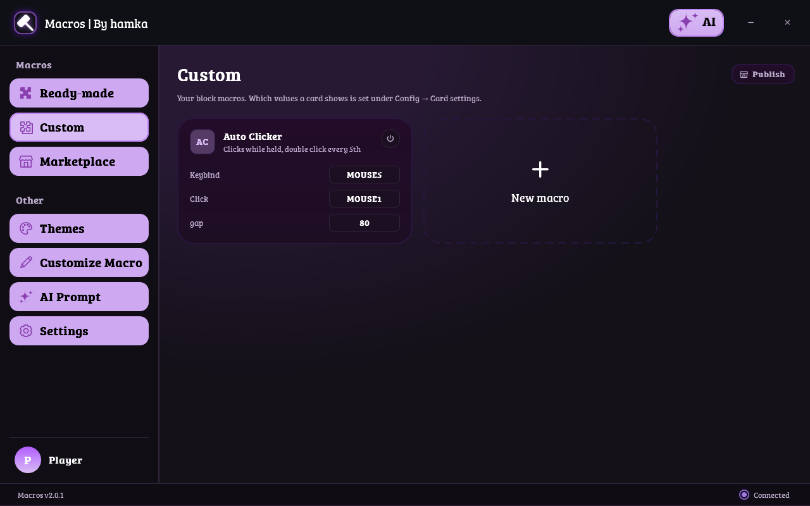
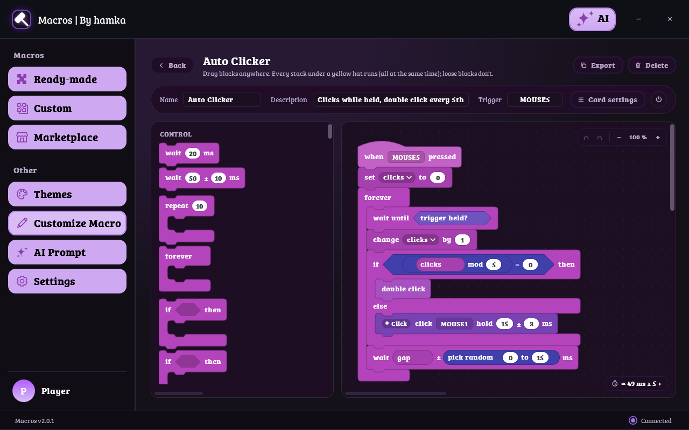
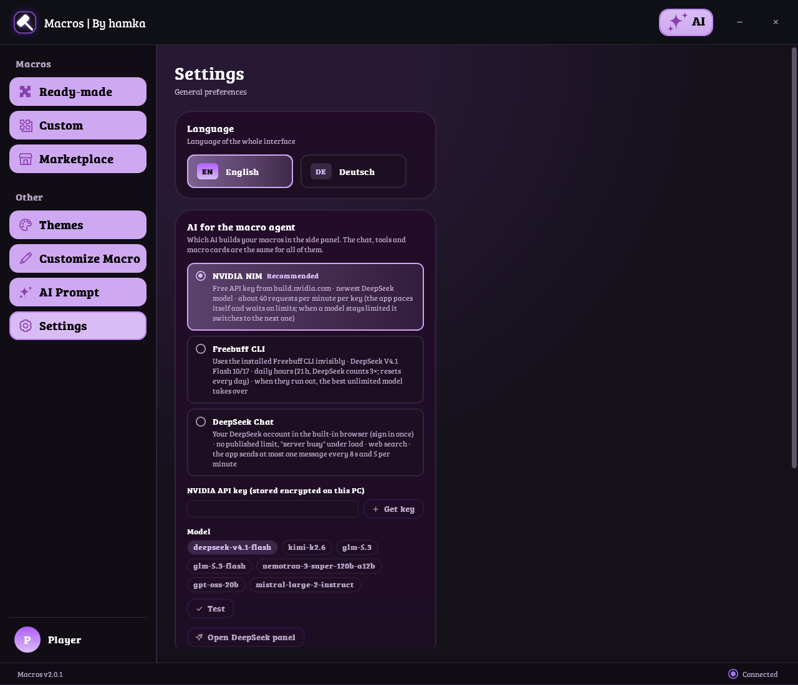
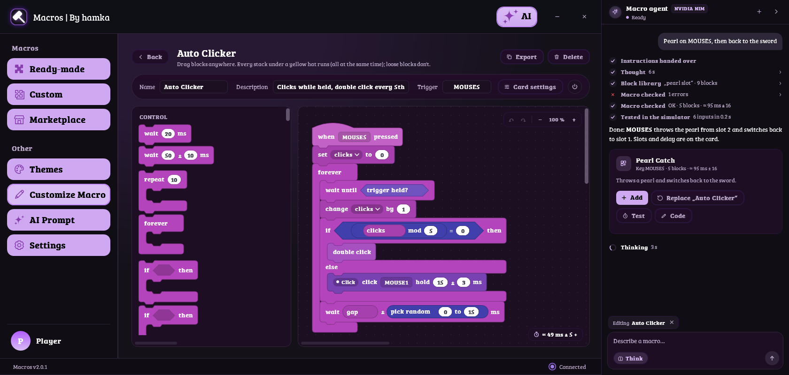
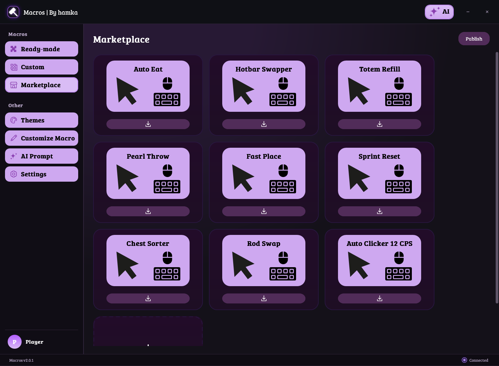
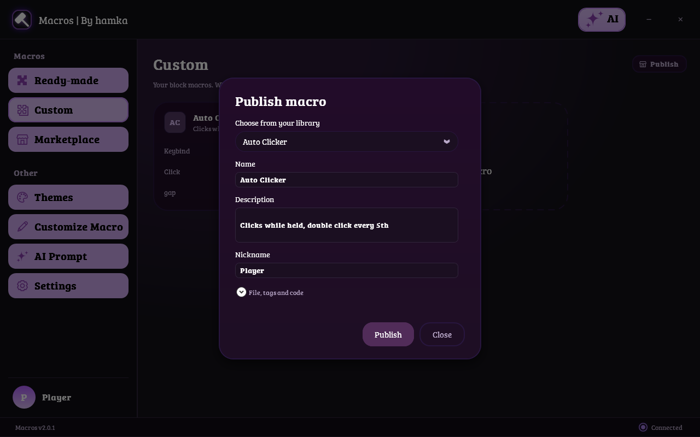
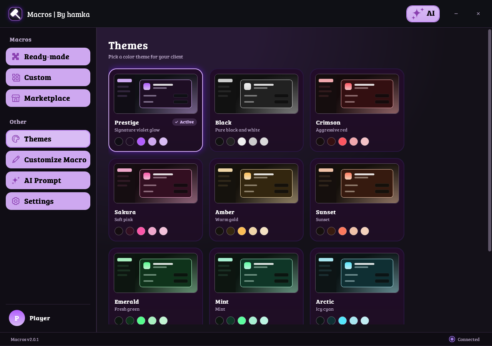

# Macros | By hamka

**Baue eigene Eingabe-Makros aus Scratch-Blöcken oder lass eine KI sie für dich bauen.**
Windows · eine einzige Exe · Deutsch & English · [English version](README.md)



---

## ⚠️ Bitte zuerst lesen

**Macros automatisiert deine eigene Maus- und Tastatureingabe. Es ist kein Cheat-Client und darf nicht als solcher benutzt werden.**

- **Benutze es nur dort, wo es erlaubt ist:** auf deinem eigenen Rechner, in Einzelspielerwelten, auf privaten Servern und in Communities, die Makros ausdrücklich erlauben, zum Üben und Trainieren und als Hilfe (zum Beispiel, wenn dir eine sich wiederholende Eingabe abgenommen werden soll).
- **Benutze es nicht** auf Servern, in Spielen, Turnieren oder Ranglisten-Modi, deren Regeln Automatisierung oder Makros verbieten. Viele öffentliche Multiplayer-Server tun das. **Lies vorher die Regeln, bevor du etwas einschaltest.**
- Wer ein Makro dort benutzt, wo es nicht erlaubt ist, kann **gebannt** werden. Das ist **deine Entscheidung und deine Verantwortung**. Es gibt **keinen Support**, um Anti-Cheat-Systeme zu umgehen, und danach soll auch nicht gefragt werden.
- **Nutzung auf eigenes Risiko.** Die Software wird „wie sie ist“ ohne jede Gewährleistung bereitgestellt. Der Autor haftet nicht für Banns, verlorene Konten, verlorenen Fortschritt, beschädigte Dateien oder sonstige Folgen der Nutzung.
- Die optionale Minecraft-Mod (*Macros Bridge*) **liest** nur Spielinformationen. Sie verändert das Spiel nicht, sendet keine Pakete und bewegt den Spieler nicht.
- Makros aus dem Marktplatz stammen von anderen Menschen. Sieh dir an, was ein Makro tut (im Block-Editor öffnen), bevor du es einschaltest.

Wenn du damit nicht einverstanden bist, benutze das Programm nicht.

---

## Was es kann

| | |
|---|---|
| **Fertige Makros** | Einige fertige, einstellbare Makros (zum Beispiel *Stun Slam*) mit Taste, Verzögerung und Slots direkt auf der Karte. |
| **Eigene Makros** | Deine Makros als Karten. Karte anklicken schaltet sie ein, Doppelklick öffnet den Block-Editor. |
| **Block-Editor** | Blöcke wie bei Scratch: Pausen, Tasten- und Mausaktionen, Schleifen, Bedingungen, Variablen, Listen, eigene Blöcke und optionale Minecraft-Blöcke. Mehrere Stapel laufen gleichzeitig. |
| **KI-Makro-Agent** | Beschreibe, was du willst. Der Agent baut das Makro, prüft es, testet es in einem Simulator und gibt dir eine Karte (*Hinzufügen / Ersetzen / Testen*). |
| **Marktplatz** | Teile deine Makros und füge die anderer mit einem Klick hinzu. Kein Konto nötig. |
| **Themes** | 13 Themes, von sanftem Pastell bis zu reinem Schwarz. |





*(Die Bilder zeigen die englische Oberfläche; in den Einstellungen kannst du auf Deutsch umstellen.)*

---

## Installation

1. Lade **Macros.zip** (oder nur **Macros.exe**) vom [neuesten Release](https://github.com/Hamstiguy/Hamka-Macros/releases/latest) herunter.
2. Entpacken und **Start Macros.cmd** ausführen. Beim ersten Start wird das Herausgeber-Zertifikat als vertrauenswürdig eingetragen (Windows fragt einmal nach Administratorrechten) und die Markierung „aus dem Internet heruntergeladen“ entfernt.
3. Danach aktualisiert sich die App selbst über neue Releases.

Voraussetzung: Windows 10 oder 11 (64 Bit). Windows kann einen SmartScreen-Hinweis zeigen, weil das Programm mit einem selbst erstellten und nicht mit einem gekauften Zertifikat signiert ist. Installiere es nur von der Release-Seite oben.

> Die eine Exe reicht. Deine Einstellungen liegen in `%APPDATA%\PrestigeMacros`.

---

## Schnellstart: dein erstes Makro

1. Öffne **Eigene Makros** und klicke auf die gestrichelte Kachel **Neues Makro** (das Plus). Es entsteht ein funktionierendes Start-Makro: *klicken, solange die Taste gehalten wird*.
2. Klicke die neue Karte an, um sie einzuschalten. Beim Darüberfahren leuchtet sie, und man sieht, was ausgewählt ist.
3. Doppelklick auf die Karte (oder **Makro anpassen**) öffnet den Block-Editor.
4. Ziehe Blöcke aus der Palette links in die Arbeitsfläche. Zahlen änderst du direkt im Block. Werte, die auf der Karte stehen sollen, bekommen einen Namen (*Karten-Einstellungen*).
5. Wähle oben die **Auslöser-Taste**.
6. Teilen? **Marktplatz → Veröffentlichen** (siehe unten).

> Tipp: Du weißt nicht, welchen Block du brauchst? Drücke **KI** (oben rechts) und beschreibe das Makro einfach.

---

## KI-Makro-Agent einrichten

Das Seitenpanel öffnest du mit dem **KI**-Knopf. Welche KI antwortet, stellst du in **Einstellungen → KI für den Makro-Agenten** ein. Chat, Werkzeuge und Makro-Karten sind bei allen drei gleich.



### Variante A – NVIDIA NIM (empfohlen)

Kostenloser API-Schlüssel, etwa 40 Anfragen pro Minute. Die App teilt sich das selbst ein und wechselt zum nächsten Modell, wenn eins ausgelastet ist.

1. In **Einstellungen → KI für den Makro-Agenten** **NVIDIA NIM** wählen und auf **Schlüssel holen** klicken. Das öffnet `build.nvidia.com`.
2. Dort anmelden (kostenloses NVIDIA-Konto) und einen **API-Schlüssel** erstellen.
3. Den Schlüssel in der App bei **NVIDIA-API-Schlüssel** einfügen. Er wird **verschlüsselt auf diesem PC** gespeichert (Windows DPAPI) und nie wieder angezeigt.
4. **Testen** klicken. Eine winzige Anfrage zeigt, ob der Schlüssel funktioniert.
5. Ein Modell wählen (Standard `deepseek-v4.1-flash`) und das KI-Panel öffnen.

### Variante B – Freebuff-CLI

Nutzt das Kommandozeilenwerkzeug Freebuff, das unsichtbar im Hintergrund läuft. Es hat tägliche Gratisstunden; sind die des Premium-Modells aufgebraucht, nimmt die App das beste unbegrenzte.

1. [Node.js](https://nodejs.org) installieren, dann im Terminal:
   ```bash
   npm install -g freebuff
   ```
   (oder in den Einstellungen **Freebuff installieren** drücken).
2. Einmal anmelden:
   ```bash
   freebuff login
   ```
3. In **Einstellungen → KI für den Makro-Agenten** **Freebuff CLI** wählen. Die App findet das installierte Werkzeug selbst.

### Variante C – DeepSeek Chat (dein eigenes Konto)

Nutzt dein DeepSeek-Konto in einem eingebauten Browser (Microsoft Edge WebView2). Kein API-Schlüssel.

1. In den Einstellungen **DeepSeek Chat** wählen und das KI-Panel öffnen.
2. Die echte DeepSeek-Seite erscheint einmal. **Melde dich dort selbst an.** Die App tippt nie deine Zugangsdaten, und die Anmeldung bleibt auf diesem PC gespeichert.
3. Danach verschwindet die Seite und du chattest in der App. Die App sendet höchstens alle 8 Sekunden eine Nachricht. Bei Last kann „Server busy“ erscheinen.

Lädt DeepSeek nicht, installiere die **WebView2-Runtime** von Microsoft Edge.

### Variante D – Deine eigene KI (lokal oder jede API)

Nutze ein Modell auf deinem eigenen PC oder eine beliebige API. Es geht nichts woandershin als an die Adresse, die du einträgst.

1. In **Einstellungen → KI für den Makro-Agenten** **Eigene KI (lokal oder API)** wählen.
2. Die **API-Art** wählen, die dein Server spricht: **OpenAI Chat Completions** (Ollama, LM Studio, llama.cpp, vLLM, OpenRouter und die meisten anderen), **OpenAI Responses** oder **Anthropic Messages**.
3. Die **Serveradresse** eintragen, zum Beispiel `http://localhost:11434` (Ollama), `http://localhost:1234` (LM Studio), `https://api.openai.com` oder `https://api.anthropic.com`. Bei einer Adresse ohne Pfad wird `/v1` ergänzt.
4. Den **API-Schlüssel** eintragen, falls der Server einen braucht. Lokale Server brauchen meist keinen. Der Schlüssel wird verschlüsselt auf diesem PC gespeichert.
5. **Modelle laden** klicken, eins auswählen (im Feld tippen zum Filtern oder einen beliebigen Namen eintragen) und **Testen** drücken.

Einfaches `http://` ist nur für deinen eigenen PC und dein Heimnetz erlaubt. Server im Internet müssen `https://` nutzen.

### Den Agenten benutzen

- Schreibe, was du willst: *„Klicke, solange ich Maus 5 halte, etwa 12 Klicks pro Sekunde, mit etwas Zufall.“*
- Das Panel zeigt, was der Agent tut: Denken, Blockbibliothek durchsuchen, Makro schreiben, prüfen, im Simulator testen.
- Am Ende bekommst du eine Makro-Karte mit **Hinzufügen**, **Ersetzen „…“** (wenn du eins im Editor offen hast), **Testen** und **Code**.
- **Denken** gibt der KI mehr Zeit zum Überlegen; **Web** (wo verfügbar) erlaubt ihr die Internetsuche.
- Ein Wechsel des Anbieters startet einen neuen Chat.



Datenschutz: Deine Nachrichten und der Makrotext gehen an den gewählten Anbieter (NVIDIA, Freebuff oder DeepSeek). Schreibe keine Geheimnisse in den Chat.

---

## Marktplatz


*Beispieleinträge zur Veranschaulichung.*

- **Hinzufügen:** Auf die Download-Leiste einer Karte klicken. Das Makro wird vor dem Hinzufügen geprüft und **ausgeschaltet** hinzugefügt.
- **Veröffentlichen:** **Veröffentlichen** klicken, eins deiner Makros wählen, Name, Kurzbeschreibung und Tags eintragen und **Makro veröffentlichen** klicken.



Regeln des Marktplatzes:

- Das unveränderte **Start-Makro** (mit dem jedes neue Makro beginnt) kann nicht veröffentlicht werden, egal welche Werte es hat. Bau erst etwas Eigenes.
- Titel mit anstößigen Wörtern werden abgelehnt; Autorennamen mit solchen Wörtern erscheinen als „Anonym“.
- Uploads sind begrenzt: **einer pro Minute** pro Gerät, dann **5 pro Stunde und 15 pro Tag**, sowie **8 pro Stunde und 25 pro Tag** pro Netzwerk. Wenn du ein Limit erreichst, sagt dir die App, wie lange du warten musst.
- Jeder Eintrag kann gemeldet werden. Gemeldete Einträge werden geprüft.

---

## Themes

13 Themes, darunter das pastellige **Prestige**, **Light** und ein schlichtes **Black**. Der Wechsel ist sofort.



---

## Minecraft-Blöcke (optional)

Wenn du Minecraft spielst, lässt dich die Fabric-Mod *Macros Bridge* (Installation in den **Einstellungen**) Informationen wie Leben, Hunger, Items und Wesen in der Nähe **lesen**, damit Makros auf das Spielgeschehen reagieren können. Die Mod ist nur lesend. Viele Server verbieten Client-Mods und Makros; lies deshalb oben **Bitte zuerst lesen**, bevor du sie online benutzt.

---

## Tipps & Fehlersuche

- **Ein Makro tut nichts:** Ist die Karte eingeschaltet und die richtige Taste als Auslöser gesetzt?
- **Ein Makro ist zu schnell oder zu langsam:** Die meisten Blöcke haben eine Zeit mit *±*-Zufallsbereich. Ändere sie auf der Karte.
- **„Bitte warte …“ beim Veröffentlichen:** Du hast das Upload-Limit erreicht; warte die angezeigte Zeit.
- **Die KI meldet, der Gratis-Zugang sei ausgelastet:** Die App probiert automatisch das nächste Modell; warte kurz oder wähle einen anderen Anbieter.

---

## Für Entwickler

Überblick und Interna stehen in [CONTEXT.md](CONTEXT.md). Das Marktplatz-Backend (Cloudflare Worker + D1) steht in [docs/market-backend.md](docs/market-backend.md).

## Lizenz und Dank

Gemacht von **hamka**. Lizenz: [Apache License 2.0](LICENSE). Nicht verbunden mit Mojang, Microsoft, NVIDIA, DeepSeek oder Freebuff; alle Namen gehören ihren Inhabern.
